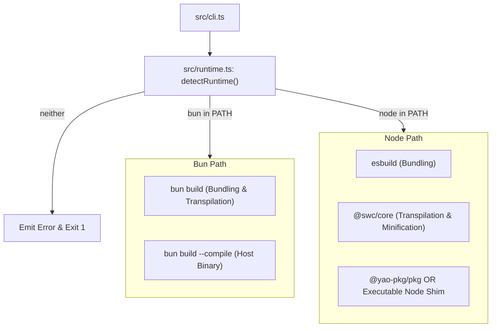
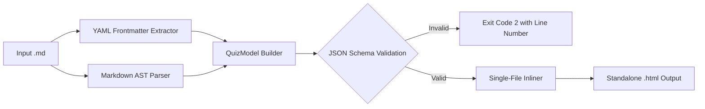

# Technical Specification: md-questioner

**Version:** 1.0.0  
**Status:** Approved  
**Author:** Orchestrator  
**Target:** Node.js (>=20) & Bun (>=1.0) Host Environments

---

## 1. System Overview & Mission

`md-questioner` is a command-line interface (CLI) compiler that translates structured Markdown study guides (written in a Markdown-native Q&A domain-specific language) into a standalone, offline, single-file interactive HTML quiz application.

The tool is engineered specifically for **focused study practice** rather than high-stakes exam simulation or gamified training:
- **Calm, sequential user experience**: Sequential question progression, clean visual hierarchy, and minimal distractions.
- **Strictly offline operation**: Zero network calls, zero external CDN scripts/fonts, and 100% functionality when loaded directly via `file://`.
- **Single-file packaging**: The emitted `.html` artifact bundles all HTML structure, design tokens, responsive styles, React runtime, UI components, syntax-highlighting themes, and parsed quiz data.
- **Claude Skill encapsulation**: Ships as an agent-callable skill in `dist/` with human-readable and machine-readable reference artifacts and a host-executable binary.

---

## 2. Toolchain & Runtime Architecture

The build toolchain automatically detects and adapts to the host environment at runtime.



### 2.1 Runtime Detection Matrix
- `detectRuntime()` evaluates available binaries via `process.versions.bun` or checking system `PATH`.
- **Bun Present**: Uses native Bun bundler and transpiler; binary compilation invokes `bun build --compile src/cli.ts --outfile dist/scripts/md-questioner`.
- **Node Present**: Uses `esbuild` for bundling and `@swc/core` for JSX/TS transpilation; binary compilation attempts `@yao-pkg/pkg` targeting host OS, falling back gracefully to an executable Node launcher shim (`#!/usr/bin/env node` invoking bundled CLI).
- **Parity Guarantee**: The emitted HTML generated through Bun and Node must be functionally equivalent and pass identical verification suites.

---

## 3. Data Flow Architecture

The compiler executes a deterministic multi-stage pipeline:



### 3.1 Pipeline Stages
1. **I/O & Traversal**: Read file or recursively collect `.md` files in directory mode.
2. **Frontmatter Extraction**: Parse YAML block (`title`, `description`, `author`, `tags`) via `yaml`.
3. **AST Construction**: Parse Markdown via `mdast-util-from-markdown` with `mdast-util-gfm` to maintain accurate source position tokens (`line`, `column`).
4. **Model Mapping**:
   - Extract page H1 as title.
   - Group by H2 headings as sections (tabs).
   - Group by H3 headings as questions.
   - Identify hint blockquotes immediately following H3.
   - Identify question types by inspecting the AST structure under each H3.
5. **Schema Validation**: Validate the constructed `QuizModel` against JSON Schema Draft 2020-12 using `ajv`. On validation failure, output source line numbers, file path, and exit with code 2.
6. **Code Highlighting & Formatting**: Parse embedded markdown paragraphs and fenced code blocks using `marked` and curated `highlight.js`.
7. **HTML Assembly**: Inset compiled React bundle, scoped CSS variables, and serialized JSON state into `template.html`.

---

## 4. Markdown Q&A DSL & Detection Rules

The DSL is CommonMark and GitHub Flavored Markdown (GFM) compliant with standard structural conventions:

### 4.1 Document Skeleton
```markdown
---
title: System Design Primer
description: Fundamental scalability concepts
author: Hollowheap
tags: [distributed-systems, storage]
---

# System Design Primer

> Lead-in introduction paragraph rendered beneath title.

## Consistency Models

### What does CAP theorem trade off?

> Think about network partitions.

- [ ] Consistency and Durability
- [x] Consistency and Availability
- [ ] Availability and Durability
```

### 4.2 Resolved Question-Type Detection Priority

When processing an H3 section, detection rules are evaluated in the following strict order:

| Priority | AST Match Pattern | Inferred Question Type | UI Interaction | Validation / Scoring Rule |
| :---: | :--- | :--- | :--- | :--- |
| **1a** | H4 heading `#### Rubric` with task list criteria | **Essay** | Textarea with word count, keyword concept highlighting, side-by-side model answer review, and interactive rubric checklist | Approach A + B: In-browser stemming concept matcher pre-checks detected points; student verifies checklist against model answer |
| **1b** | Other H4 immediately under H3 (`#### <answer>`) | **Short Answer** | Single-line text input field | Case-insensitive trimmed match; Levenshtein distance $\le 1$ allowed |
| **2** | GFM Table in question body | **Match Pairs** | Left column static prompts, right column dropdowns | All left items must match corresponding right items |
| **3a** | Task list with exactly 2 items: "True" and "False" (case-insensitive) | **True / False** | Two toggle choice buttons | Selected option must match the single `[x]` |
| **3b** | Task list with exactly one `[x]` and $>2$ items | **Multi Choice** | Radio options list | Single selection must match `[x]`; explanation paragraph shown on check |
| **3c** | Task list with $>1$ `[x]` | **Multi Select** | Checkbox options list | Exact set of `[x]` items must be checked (all-or-nothing, no partial credit) |
| **3d** | Task list with 0 `[x]` | **Schema Error** | N/A | **Validation failure (Exit code 2)**: Choice questions must indicate correct answer |
| **4** | Blockquote present, no answer-bearing AST element | **Reflection** | Multi-line textarea for self-assessment | Clicking "Next" marks question as practiced |
| **5** | Any other AST structure under H3 | **Reflection** | Multi-line textarea (with warning logged) | Counted as practiced when user proceeds |

### 4.3 Hint Extraction Rule
- The **first** `>` blockquote appearing between an H3 and the first answer-bearing element is parsed as the question's **hint**.
- The hint is rendered as a collapsible accordion ("Show hint"), collapsed by default.
- Any subsequent blockquotes appearing after the first hint or after answer elements are treated as explanatory prose.

### 4.4 Explanation Extraction Rule
- For choice questions, a paragraph appearing immediately after the task list is parsed as the **explanation**.
- The explanation is hidden initially and revealed when the user clicks "Check" or "Reveal".

---

## 5. Quiz Data Model (`QuizModel`)

```typescript
export type QuestionType =
  | "multi-choice"
  | "multi-select"
  | "true-false"
  | "match-pairs"
  | "short-answer"
  | "reflection"
  | "essay";

export interface ChoiceOption {
  id: string;
  text: string;
  isCorrect: boolean;
}

export interface MatchPair {
  prompt: string;
  answer: string;
}

export interface Question {
  id: string;
  title: string;
  type: QuestionType;
  hint?: string;
  promptHtml?: string;
  explanationHtml?: string;
  sourceLine: number;
  // Type-specific payloads:
  options?: ChoiceOption[];       // multi-choice, multi-select, true-false
  pairs?: MatchPair[];            // match-pairs
  canonicalAnswer?: string;       // short-answer
  fuzzyTolerance?: number;        // short-answer (default 1)
  rubric?: string[];              // essay
  modelAnswerHtml?: string;       // essay
}

export interface Section {
  id: string;
  title: string;
  questions: Question[];
}

export interface Frontmatter {
  title?: string;
  description?: string;
  author?: string;
  tags?: string[];
  [key: string]: unknown;
}

export interface QuizModel {
  title: string;
  description?: string;
  frontmatter: Frontmatter;
  sections: Section[];
  contentHash: string;
  totalQuestions: number;
}
```

---

## 6. Theming & Design Token System

The design system is extracted from steep.app (Refero tokens) and extended with a high-contrast, warm dark mode passing WCAG AA standards.

### 6.1 Light Palette
```css
[data-theme="light"] {
  --ink-black:      #17191c; /* primary text, dark filled buttons */
  --paper-white:    #ffffff; /* page canvas, elevated card surfaces */
  --mist-gray:      #f2f2f3; /* secondary card surfaces, input fills */
  --fog-white:      #fafafb; /* alternating backgrounds, hover states */
  --slate-gray:     #777b86; /* muted helper text, inactive borders */
  --ash-gray:       #979799; /* tertiary labels, category tags */
  --smoke-gray:     #a3a6af; /* placeholders, disabled borders */
  --blush-peach:    #fbe1d1; /* warm accent highlight wash */
  --sienna-brown:   #5d2a1a; /* accent text/stroke on blush peach */

  --color-canvas:   var(--paper-white);
  --color-surface:  var(--fog-white);
  --color-card:     var(--paper-white);
  --color-border:   #e1e2e5;
  --color-text:     var(--ink-black);
  --color-muted:    var(--slate-gray);
  --color-accent:   var(--sienna-brown);
  --color-accent-bg:var(--blush-peach);
}
```

### 6.2 Dark Palette (WCAG AA Certified)
```css
[data-theme="dark"] {
  --dm-surface-0:   #14181a; /* page canvas */
  --dm-surface-1:   #1b2024; /* cards, sidebar */
  --dm-surface-2:   #232a2e; /* nested surfaces, input fills */
  --dm-text-hi:     #e8e6e1; /* primary text - warm off-white (contrast > 12:1) */
  --dm-text-mid:    #a8a29a; /* muted, secondary (contrast > 5.5:1) */
  --dm-text-lo:     #6f6a63; /* disabled / placeholders */
  --dm-accent:      #7fb88a; /* warm green - buttons, active tab (contrast > 6.2:1) */
  --dm-accent-soft: #2a3a30; /* green-tinted surface wash */
  --dm-accent-ink:  #101613; /* text on accent background (contrast > 8.5:1) */
  --dm-border:      #2e353a;

  --color-canvas:   var(--dm-surface-0);
  --color-surface:  var(--dm-surface-1);
  --color-card:     var(--dm-surface-1);
  --color-border:   var(--dm-border);
  --color-text:     var(--dm-text-hi);
  --color-muted:    var(--dm-text-mid);
  --color-accent:   var(--dm-accent);
  --color-accent-bg:var(--dm-accent-soft);
}
```

### 6.3 Typography
- **Serif Stack (`--font-serif`)**: `"Iowan Old Style", "Charter", "Source Serif 4", "Source Serif Pro", Georgia, "Times New Roman", serif;` — applied to document titles, H1, H2, H3, question bodies, and explanations.
- **Sans-Serif Stack (`--font-sans`)**: `system-ui, -apple-system, "Segoe UI", Roboto, "Helvetica Neue", Arial, sans-serif;` — applied to UI controls, buttons, section tabs, sidebar links, status badges, and steppers.
- **Monospace Stack (`--font-mono`)**: `ui-monospace, SFMono-Regular, Menlo, Consolas, "Liberation Mono", monospace;` — applied to code blocks and inline code.

---

## 7. Interactive Quiz Engine

### 7.1 Component Architecture
```
src/render/
  Provider.tsx        # Gluestack theme token provider + DarkModeContext
  App.tsx             # Root state controller (active section, active index, score map)
  Sidebar.tsx         # Section tree, question jump links, progress widget (drawer on mobile)
  SectionTabs.tsx     # Top horizontal tabs (rendered if sections.length > 1)
  Question.tsx        # Active question host, prompt renderer, and hint accordion
  Hint.tsx            # Collapsible hint accordion
  Stepper.tsx         # Sticky bottom nav: Prev, Q X / Y, Next, Submit
  Progress.tsx        # Overall and section-level progress bars
  Shuffle.tsx         # In-section shuffle button (hideable via --no-shuffle)
  ThemeToggle.tsx     # Theme switcher (light, dark, auto)
  question-types/
    MultiChoice.tsx   # Radio group with check and reveal states
    MultiSelect.tsx   # Checkbox list with all-or-nothing validation
    TrueFalse.tsx     # True / False button toggle
    MatchPairs.tsx    # Drag/dropdown matching pairs
    ShortAnswer.tsx   # Free-text input with Levenshtein fuzzy matching
    Reflection.tsx    # Self-assessment textarea
```

### 7.2 State & Persistence Strategy
- **Persistence Key**: `localStorage["mdq-progress-" + contentHash]` stores:
  ```typescript
  interface SavedState {
    activeSectionIndex: number;
    activeQuestionIndex: number;
    answeredQuestions: Record<string, {
      isCorrect: boolean;
      userResponse: unknown;
    }>;
  }
  ```
- Recompiling an unchanged document retains progress. Modifying the Markdown updates the SHA-256 `contentHash`, automatically resetting stale state.
- **Theme Storage**: `localStorage["mdq-theme"]` (`"light" | "dark" | "auto"`). Fallback to `window.matchMedia("(prefers-color-scheme: dark)")`.

---

## 8. Single-File Bundler & Size Budget

- **Target Size**: Strictly `< 10 MB` (actual bundle footprint target: `< 800 KB`).
- **Syntax Highlighting**: Highlight.js restricted strictly to 13 curated languages:
  `js`, `ts`, `tsx`, `jsx`, `python`, `go`, `rust`, `sql`, `bash`, `json`, `yaml`, `html`, `css`, `md`.
- **Inliner Pipeline (`src/bundle/inline.ts`)**:
  1. Bundles React application with entry point into a single IIFE JavaScript string.
  2. Inlines all CSS tokens and component styles into `<style>` tags.
  3. Serializes `QuizModel` into `<script type="application/json" id="mdq-data">`.
  4. Merges into `template.html` with zero external resource tags.

---

## 9. CLI Interface & Exit Codes

```
md-questioner <input> [-o <output>] [--theme light|dark|auto] [--no-shuffle]
              [--title "..."] [--quiet] [--verify] [--version]
```

### 9.1 Exit Codes
- `0`: Successful compilation.
- `1`: General runtime or I/O error (e.g., file not found, missing runtime).
- `2`: Schema validation failure (prints source file, line number, and human-readable error).

---

## 10. Packaging & Verification Plan

### 10.1 Claude Skill Package (`dist/`)
- `dist/SKILL.md`: Claude Skill descriptor and trigger rules.
- `dist/reference/`:
  - `example.md`: Comprehensive study guide exercising all question types and hints.
  - `schema.md`: Human-readable DSL specification for agents.
  - `schema.json`: JSON Schema Draft 2020-12 specification.
  - `design-tokens.json` & `design-tokens.md`: Formal token definitions.
- `dist/scripts/`:
  - `md-questioner`: Host-executable compiled binary or launcher shim (`chmod +x`).
  - `README.md`: Agent invocation instructions.

### 10.2 Mandatory Verification Suite (§10 Checks)
All 8 verification checks must pass and log results to `artifacts/VERIFICATION.md`:
1. Schema round-trip deep equality.
2. Render smoke test (single file, no external assets).
3. Offline check (file:// URL loading, zero network requests, React hydration).
4. Style application (serif typography computed, AA dark accent).
5. Size cap (< 10 MB).
6. Mobile responsiveness (375x667 drawer layout and sticky stepper).
7. Dark mode toggle functionality.
8. Directory batching mode.
